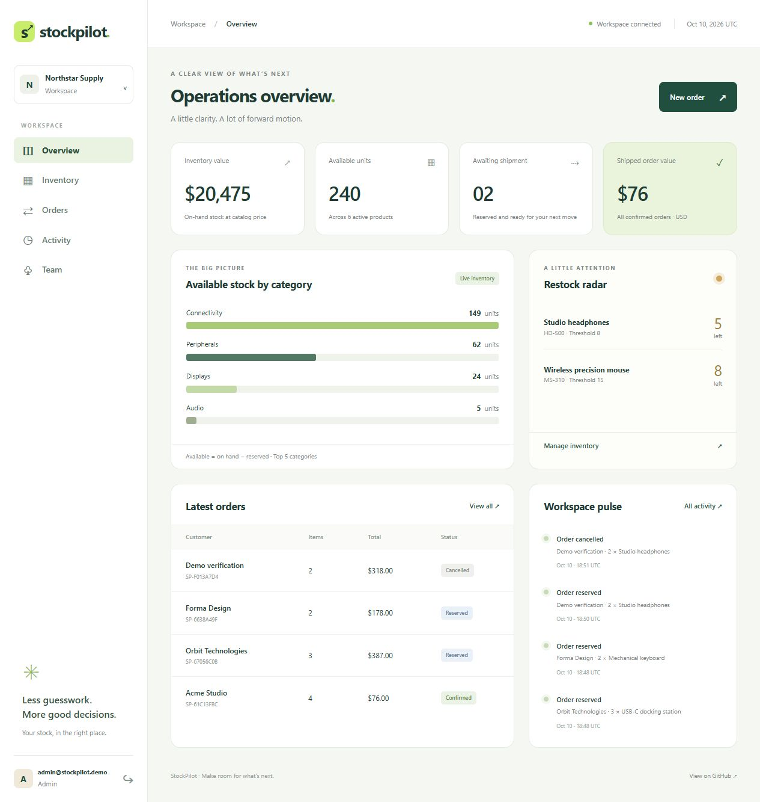

# StockPilot

[](https://github.com/ZiadMaghraby/StockPilot/actions/workflows/ci.yml)
[](https://dotnet.microsoft.com/)
[](LICENSE)

**A clear view of your inventory, orders, and team operations.**

StockPilot is a multi-tenant inventory application built with ASP.NET Core 10, EF Core, Identity, and Razor Pages. It focuses on the parts that make inventory software interesting: company isolation, concurrent stock reservations, safe retries, and auditable order transitions.



## What works today

- **Company workspaces:** register a company or add members with Admin, Operator, and Viewer roles.
- **Inventory:** add products, search by name/SKU, receive stock, and see on-hand, reserved, and available quantities.
- **Orders:** reserve stock, confirm shipment, or cancel and release it.
- **Safe retries:** tenant-scoped request IDs prevent duplicate reservations.
- **Auditability:** stock movements and operational changes are recorded with actor and UTC timestamp.
- **Dashboard:** inventory value, available stock, pending shipments, low-stock alerts, and recent activity.
- **HTTP API:** authenticated endpoints with CSRF protection and an OpenAPI document.
- **Verification:** 27 HTTP integration cases and 36 tenant write-guard cases over real SQLite databases; GitHub Actions builds, tests, and publishes.

This is **v0.1, a working portfolio/local-demo baseline**. It uses one stock location per company and one product per order. Production deployment and the next capabilities are tracked in [issues](https://github.com/ZiadMaghraby/StockPilot/issues).

## Run locally

Requires a .NET 10 SDK in the 10.0.4xx feature band. The repository uses `global.json` and locked NuGet dependencies.

```sh
git clone https://github.com/ZiadMaghraby/StockPilot.git
cd StockPilot
dotnet restore --locked-mode
dotnet run --project src/StockPilot.Web --launch-profile http
```

Open **http://localhost:5188**. The Development profile creates a local SQLite database and seeds sample data on first run. No external database, JavaScript toolchain, or cloud account is needed.

| Demo account | Password | Access |
| --- | --- | --- |
| `admin@stockpilot.demo` | `StockPilot!2026` | All workspace operations |
| `operator@stockpilot.demo` | `StockPilot!2026` | Inventory receipts and order operations |
| `viewer@stockpilot.demo` | `StockPilot!2026` | Read-only workspace access |

Alternatively, choose **Create a workspace** to start an empty company. Demo accounts and data are enabled only in Development with `Demo:Enabled=true`.

## Verify

```sh
dotnet build --configuration Release --no-restore
dotnet test --configuration Release --no-build
dotnet publish src/StockPilot.Web --configuration Release --no-build --output publish
dotnet list package --vulnerable --include-transitive
```

Tests create isolated temporary SQLite databases and exercise the actual HTTP authentication and antiforgery flows. Important cases include:

- Eight concurrent buyers compete for the last unit: exactly one reservation succeeds.
- Concurrent retries with one request ID produce one order and one stock reservation.
- Shipment and cancellation race: exactly one transition wins.
- Another company cannot read, reserve, or cancel your inventory and orders.
- Every synchronous and asynchronous `SaveChanges` overload enforces tenant ownership, including calls that defer accepting tracked changes.
- Viewers cannot write; Operators cannot create products or manage the team.
- Invalid quantities/prices and overselling leave data unchanged.
- Missing, empty, or malformed order request IDs leave orders, stock, movements, and audit records unchanged; valid form retries reserve only once.
- Every operational page and the OpenAPI document renders for an administrator.

These are correctness tests, **not a throughput benchmark**. The initial dependency audit reported no known vulnerable direct or transitive packages in the configured sources.

## Try the API

Sign in through the UI and open `/openapi/v1.json`, or run the local PowerShell walkthrough while the app is running:

```powershell
./scripts/api-demo.ps1
```

The script signs in to the demo, reserves one available unit, then cancels the order. It only accepts a loopback URL. See [API documentation](docs/API.md) for routes, payloads, authentication, limits, and error codes.

## Why the stock stays consistent

```text
Available = OnHand - Reserved
0 <= Reserved <= OnHand
```

Reservations increment reserved stock only when the database can satisfy the requested quantity. The stock change, order, movement, and audit entry share one transaction. Confirmation deducts on-hand and reserved units together; cancellation only releases reserved units. Company-scoped query filters and composite foreign keys protect tenant boundaries.

Read the [architecture guide](docs/ARCHITECTURE.md) for the state machine, concurrency decisions, identity model, and trade-offs.

## Repository layout

```text
src/StockPilot.Web/
  Domain/             Business entities
  Features/           Transactional inventory and order commands
  Infrastructure/     EF Core, tenant identity, demo data, health check
  Pages/              Responsive Razor Pages interface
  wwwroot/            Local styles and favicon
  Program.cs          Composition root and HTTP API
 tests/StockPilot.Tests/ HTTP integration tests
 docs/                 Architecture, API, screenshots, and demo guide
 scripts/              Local API walkthrough
```

## Container demo

```sh
docker compose up --build
```

The supplied Compose configuration binds only to `127.0.0.1:5188`, runs the Development demo, and persists data and authentication keys in named volumes. It is intended for local evaluation. **Docker was not available in the initial development environment, so the image/Compose execution has not been validated.** The .NET Release build, tests, publish output, browser workflows, and API demo script were validated directly.

## Configuration and release limits

| Setting | Default | Purpose |
| --- | --- | --- |
| `Database:Provider` | `Sqlite` | `SqlServer` wiring is experimental and unvalidated |
| `ConnectionStrings:StockPilot` | Local SQLite file | Relational database connection |
| `Database:Initialize` | `false` outside Development | Explicit initial-schema bootstrap via `EnsureCreated` |
| `Demo:Enabled` | `false` outside Development | Development-only sample accounts/data |
| `AllowedHosts` | `localhost;127.0.0.1` | Allowed request hosts |

Environment variables use double underscores, for example `Database__Initialize`. Never commit real connection credentials.

Before a public deployment, implement versioned schema migrations and provider-specific tests, email verification/recovery and invitations, durable key storage, configured TLS/proxy handling, monitoring, and backups. `EnsureCreated` is an initial bootstrap, **not** an upgrade or migration strategy. SQL Server is not advertised as supported until its concurrency and migration work is complete. There is no hosted public demo in this release.

Additional v0.1 boundaries: USD only, no payments/tax/refunds, bounded lists without pagination, one product per order, one inventory location per company, and no claimed external users or performance figures.

## Portfolio and contribution workflow

See the [five-minute demo and CV guide](docs/DEMO-AND-CV.md), [contribution guide](CONTRIBUTING.md), and [roadmap](docs/ROADMAP.md). Work is organized as issue → branch → focused PR → CI → merge. All initial project PRs are self-authored work; they are not external maintainer endorsements.

Explore the architecture guide for design decisions, the integration tests for verified behavior, and the roadmap for planned improvements.

## License

[MIT](LICENSE) · ZiadMaghraby
