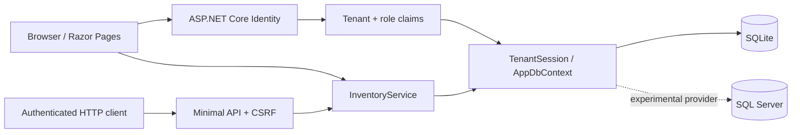
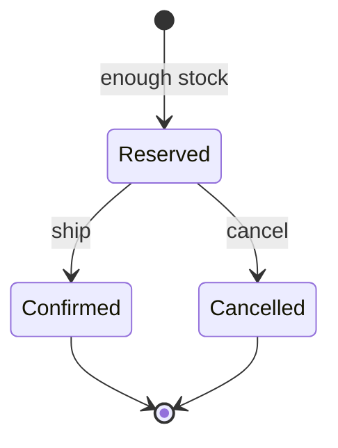

# Architecture and invariants

StockPilot is a modular monolith: one ASP.NET Core process and one relational database. It deliberately keeps the operational workflow inside a database transaction instead of adding distributed services to a small application.



## Code map

| Location | Responsibility |
| --- | --- |
| `Domain/Entities.cs` | Product, order, movement, audit, and identity models |
| `Infrastructure/TenantSession.cs` | Server-owned tenant and role identity |
| `Infrastructure/AppDbContext.cs` | Query filters, constraints, indexes, and write checks |
| `Features/InventoryService.cs` | Business validation and transactional commands |
| `Pages/` | Server-rendered dashboard, forms, and account flows |
| `Program.cs` | Composition root, middleware, HTTP API, health checks |
| `tests/StockPilot.Tests/InventoryApiTests.cs` | End-to-end HTTP integration tests |

## Company isolation

Registration generates a company identifier on the server. Team members receive the administrator's company identifier. The claims factory embeds this identifier in the protected authentication cookie; clients cannot select it through an API request body or header.

EF global query filters apply to products, orders, movements, and audit entries. `SaveChangesAsync` rejects tracked tenant-owned entities with a different tenant identifier. Composite foreign keys include `TenantId`, so an order or movement cannot reference another company's product. `ExecuteUpdate` commands use the same filtered sets. Identity users are intentionally global for sign-in; the team listing explicitly filters them by company.

These protections cover the application's current access paths. New code must preserve them: raw SQL, unfiltered Identity queries, `IgnoreQueryFilters`, or new synchronous write paths need explicit review and tests. This is application-enforced isolation, not database row-level security.

## Stock invariants

For each product:

```text
0 <= Reserved <= OnHand
Available = OnHand - Reserved
```

The database has a check constraint for the invariant. Reservation uses a conditional update equivalent to:

```sql
UPDATE Products
SET Reserved = Reserved + @quantity
WHERE TenantId = @tenant
  AND Id = @product
  AND OnHand - Reserved >= @quantity;
```

One affected row means the reservation succeeded. Zero rows returns a conflict. Reading available stock and then issuing an unconditional update would allow overselling; this application does not use that sequence.

The stock change, order insert, movement, and audit entry share a transaction. Failed commands roll back all effects. Updates use `ExecuteUpdate` and subsequent reads use `AsNoTracking`, avoiding reliance on stale tracked entity values.

## Order state machine



| Command | On hand | Reserved | Available |
| --- | --- | --- | --- |
| Receive N | +N | unchanged | +N |
| Reserve N | unchanged | +N | −N |
| Confirm N | −N | −N | unchanged |
| Cancel N | unchanged | −N | +N |

State transitions conditionally update orders only while their status is `Reserved`. Concurrent confirm/cancel requests therefore have one winner. A repeated transition returns `409 Conflict`, rather than creating duplicate movements.

## Idempotency

`(TenantId, RequestId)` is unique. A retry with the same product, quantity, normalized customer, and request ID returns the original order, including its current state. Reusing the key with a different payload returns `409`. The request key is retained on a form validation failure. SQLite transactions serialize competing writers; concurrency tests cover both duplicate keys and competing buyers.

SQL Server is wired as an optional provider but is **not validated for this release**. In particular, simultaneous same-key inserts can hit the unique constraint under its different locking behavior. Provider-specific retries, duplicate-key handling, migrations, and tests are tracked before it can be called supported.

## Money and time

Prices use integer cents (`long`) and orders snapshot the unit price at reservation time. The UI formats USD; multi-currency, tax, discounts, and refunds are outside this release. The dashboard reports catalog inventory value and shipped order value, not accounting revenue or inventory cost. Stored timestamps and displayed audit times use UTC.

## Security boundaries

- ASP.NET Core Identity hashes passwords and provides lockout after five failed attempts.
- Sign-in and registration are limited to 20 requests per minute per remote IP.
- Cookie-authenticated writes require antiforgery validation; API clients send `X-CSRF-TOKEN`.
- Admins manage products and members; Operators receive stock and manage orders; Viewers read data.
- Demo credentials are seeded only in Development with `Demo:Enabled=true`.
- HSTS and HTTPS redirection are enabled outside Development.
- Security headers restrict framing, sniffing, and external resources.

Production readiness still requires versioned migrations, email verification and recovery, invitation-based onboarding, proxy/TLS configuration, durable key storage, monitoring, backups, and a deployment-specific security review. This release is a portfolio/local-demo baseline.

## Trade-offs

Razor Pages keeps the first interface server-rendered, with built-in form antiforgery and no JavaScript framework dependency. Blazor can be evaluated later if interactive client state becomes necessary. SQLite makes the demo reproducible without a database service. Lists are deliberately bounded at 100/250 records; pagination, multi-line orders, and multiple warehouses have explicit roadmap issues.

## References

- [EF Core global query filters](https://learn.microsoft.com/en-us/ef/core/querying/filters)
- [EF Core ExecuteUpdate and transactions](https://learn.microsoft.com/en-us/ef/core/saving/execute-insert-update-delete)
- [ASP.NET Core integration testing](https://learn.microsoft.com/en-us/aspnet/core/test/integration-tests)
